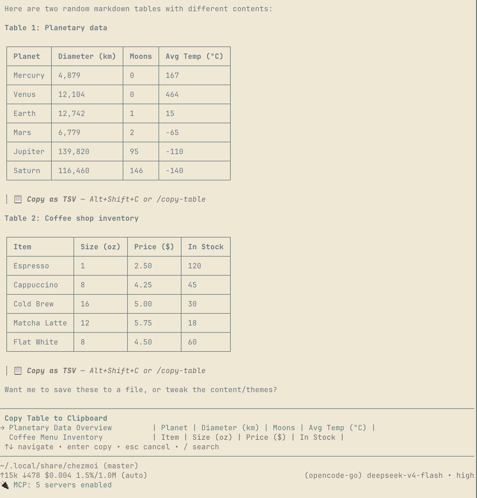

# copy-table

An agent prints a table you want in a spreadsheet. Selecting it with the mouse gives you
markdown pipes and misaligned columns; you end up cleaning it by hand.

`copy-table` puts every markdown table in the conversation one keystroke away as TSV —
`Alt+Shift+C` for the most recent one, `/copy-table` to pick from all of them. Each table
is named by a small fast model, so the picker reads like a list of tables:



## Install

```sh
mkdir -p ~/.pi/agent/extensions
cp -r copy-table ~/.pi/agent/extensions/
```

Restart pi (or `/reload`). Nothing else to configure.

## What it does

| | |
|---|---|
| `Alt+Shift+C` | copy the most recent table as TSV |
| `/copy-table` | pick any table in the conversation, by name |
| after each table | a one-line hint, so the feature is discoverable |

Markdown is converted to TSV: pipes stripped, cells trimmed, separator row dropped — the
format spreadsheets paste as columns. Clipboard goes through `pbcopy` on macOS, `wl-copy`
or `xclip` on Linux, `clip` on Windows.

## Naming

Names come from one small model call per table, fired in the background when the message
finishes, and cached on disk at `~/.pi/agent/copy-table-names.json` — so a name survives
restarts and resumed sessions, and a repeated table costs nothing. `/copy-table` names
anything not in the cache on demand, waiting at most 2.5s before opening the picker.

The model is `nemotron-3-ultra-nvfp4` on Fireworks, picked by measuring every Fireworks
serverless model on this exact task — see **[table-naming-benchmark.md](table-naming-benchmark.md)**.
Override it with `PI_COPY_TABLE_MODEL`.

The API key is read from `$FIREWORKS_API_KEY`, or from `~/.pi/agent/auth.json` if you have
logged into Fireworks in pi. **Without a key the extension still works** — copying is
entirely local; only the names fall back to `Table 1, Table 2`.

Set `PI_COPY_TABLE_DEBUG=1` to log naming requests to `/tmp/pi-copy-table.log`.

## Two things worth knowing if you write something similar

**A reasoning model with a small token budget answers with silence.** The first version
sent `max_tokens: 15`, which the model spent entirely on `reasoning_content` before it
ever started the answer. The reply was `HTTP 200` with an empty `content` — no error, no
name, nothing to catch. Send `reasoning_effort: "none"` for this kind of one-line task.

**That parameter is not portable.** Every model measured needs `reasoning_effort: "none"`,
except the `gpt-oss-*` family, which rejects it with `HTTP 400` and wants `"low"`. And two
models return an empty `content` at every effort level, so no single request body serves
all of them.
